<h1 align="center">for you</h1>

<p align="center">
  <em>A private love letter that plays like a short film.</em><br>
  Your photos and your words, behind a stained-glass gate that only one answer opens.<br>
  Encrypted before anything is published, decrypted only in their browser, hosted free on GitHub Pages.
</p>

<p align="center">
  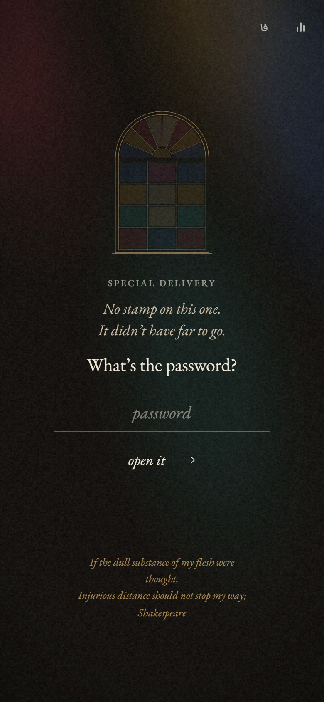
  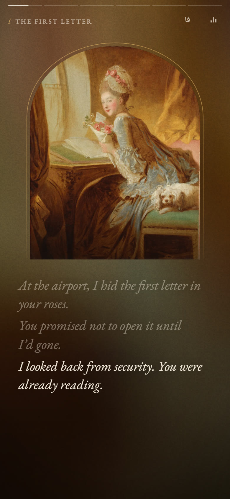
  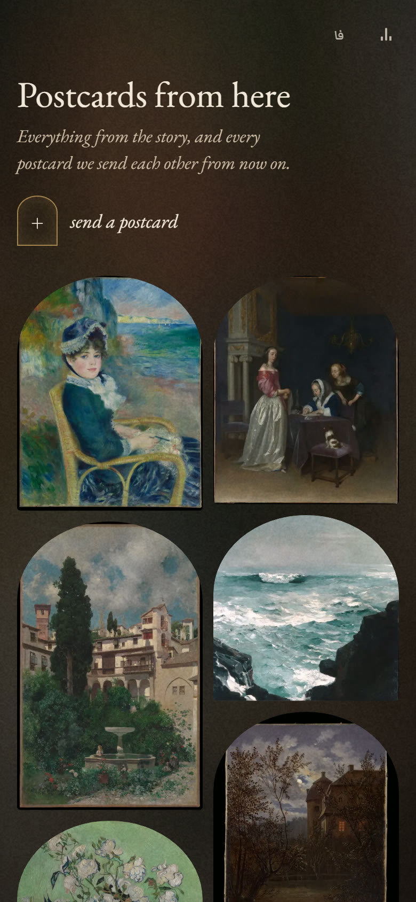
</p>
<p align="center"><sub>The screenshots use the two bundled samples: made-up words with public-domain paintings from The Met, Western paintings for the English one and Persian miniatures for the Persian one.</sub></p>

**for you** is a small website you make for one person. They open the link and answer a question only they can answer. A stained-glass window lights up pane by pane, *Clair de lune* fades in, and a short film made of your photos and your words begins: a verse, a few rooms of memories, one silly question, a hand to hold, a letter and end credits. After that comes a **shared photo wall you both keep adding to**, from either phone, for as long as you like.

You can make your own without touching the code. Put your photos in a folder, write your words in one JSON file, choose the answer and run one command. The repository and the site stay public, but every photo and every word is encrypted on your own computer before anything is published.

This repository is not only a template: the site deployed from it is a real, private gift, and to anyone without the answer it is ciphertext.

<p align="center">
  <a href="#how-it-plays">How it plays</a> ·
  <a href="#the-shared-gallery">The shared gallery</a> ·
  <a href="#in-persian">In Persian</a> ·
  <a href="#private-by-design">Private by design</a> ·
  <a href="#make-your-own">Make your own</a> ·
  <a href="#writing-your-content">Writing your content</a> ·
  <a href="#links-and-options">Links and options</a> ·
  <a href="#tech-notes">Tech notes</a> ·
  <a href="#credits-and-licenses">Credits</a>
</p>

## How it plays

1. **The gate.** A stained-glass window (an *orsi*, the colored sash window of old Persian houses) above your question. A wrong answer gets a gentle reply and a small shake; after the third, your hint appears. The right one lights the window pane by pane, each pane with a faint glass chime, and the music fades in.
2. **The opening.** A verse is written in, like ink: a classical Persian couplet in Nastaliq calligraphy with its translation, or lines of English poetry. Then come the title and a few opening lines.
3. **The rooms.** Each scene is a photo in an arched frame that develops out of a soft blur like a print, with your words appearing beneath it one line at a time. Tap or swipe to go on, tap the left edge to go back, press and hold to pause. Some rooms hold a small moment:
   - **fog** on the glass, wiped away with a fingertip before the words begin;
   - a line that arrives **mirror-written** and turns round to be read;
   - a slow **camera glide** towards one detail of the photo;
   - a **second photo** that develops in halfway through.
4. **The question.** *Do you love me?* The No button runs away (from a finger, a key press or an approaching mouse). Each time it changes its excuse and shrinks while Yes grows, until it gives up and becomes a yes. Yes sends out shards of colored light.
5. **Hold my hand.** They press and keep holding on the photo's hands. A ring fills to a soft heartbeat, which phones that support vibration also let them feel.
6. **The letter.** Your letter on a sheet of paper, with a drawn flourish under the sign-off.
7. **The credits.** A film-style roll that slows to a stop on your closing line, then a closing verse and *the end*.
8. **The shared gallery.** Every photo from the story, and every photo either of you adds afterwards, each with a caption, who added it and the date ([more below](#the-shared-gallery)). On later visits a button skips straight here, and a chapter menu link opens any room or the letter.

All of it works in Persian and English. The فا/EN button flips the whole layout to right-to-left, swipes and arrow keys included. With *reduce motion* switched on, every movement becomes a plain fade. It is built to stay smooth on a mid-range Android phone and in Firefox.

<p align="center">
  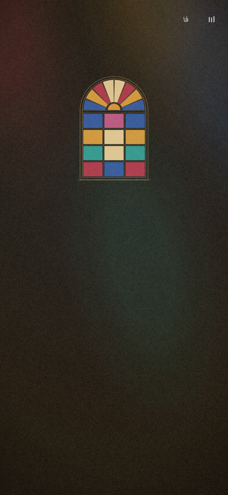
  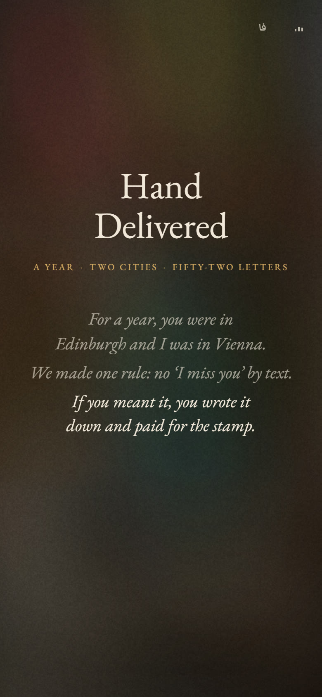
  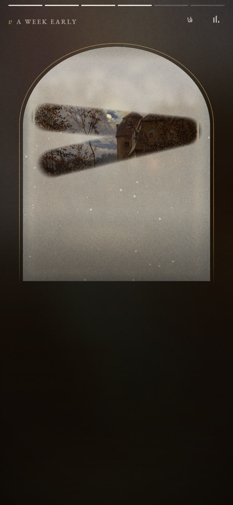
  <br><sub>The window lights up · the title · fog on the glass</sub>
</p>
<p align="center">
  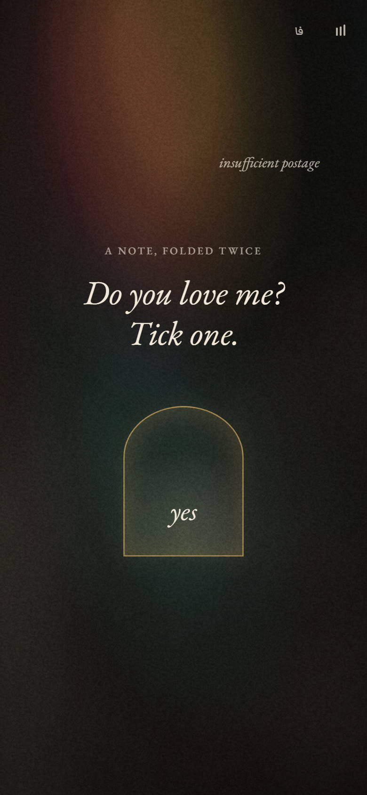
  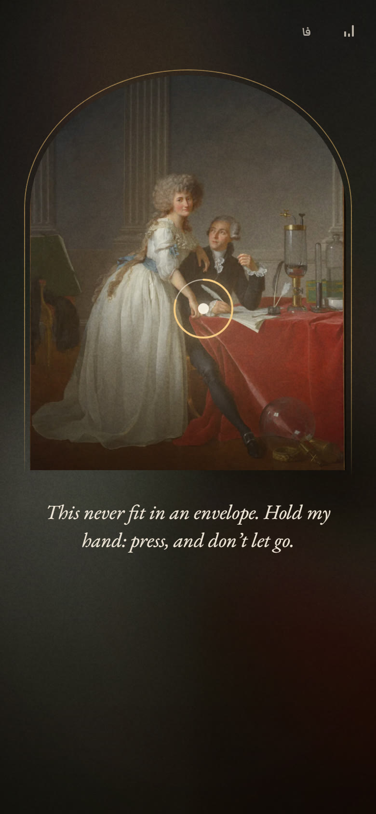
  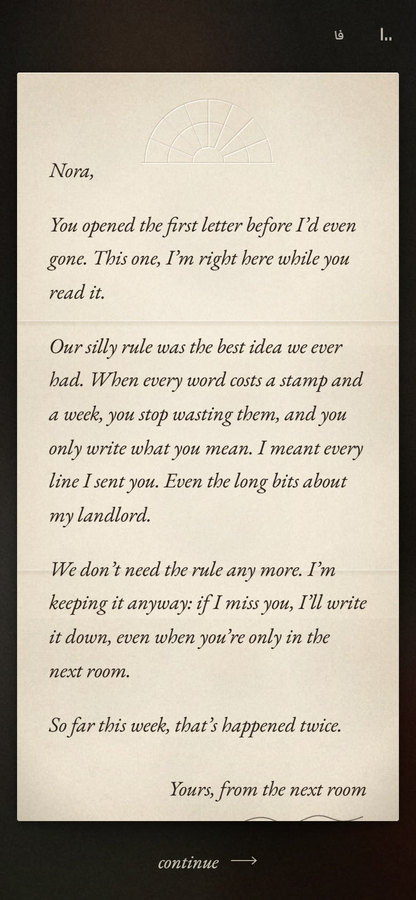
  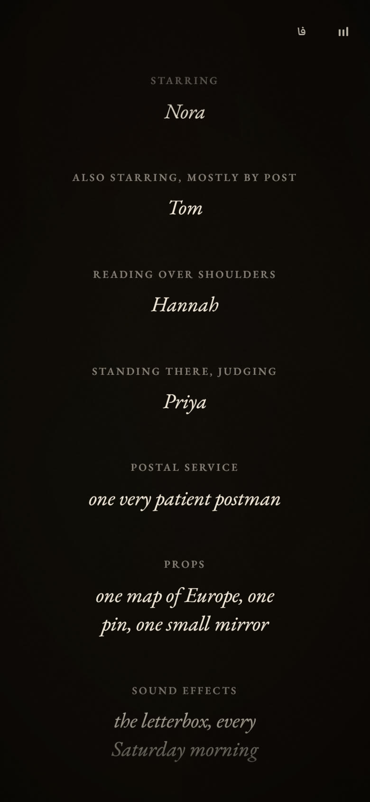
  <br><sub>The question · hold my hand · the letter · the credits</sub>
</p>
<p align="center">
  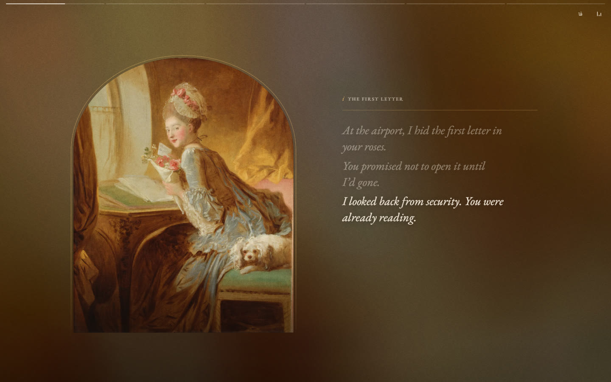
  <br><sub>On a wide screen each room becomes a quiet gallery wall: the arch on one side, a placard and the lines on the other.</sub>
</p>

## The shared gallery

The film ends on a wall of photos, and the wall keeps growing.

<p align="center">
  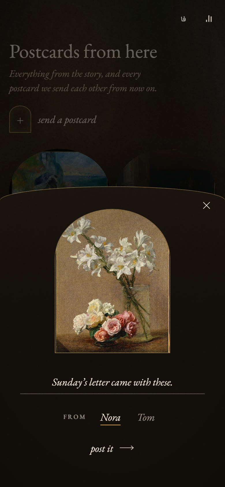
  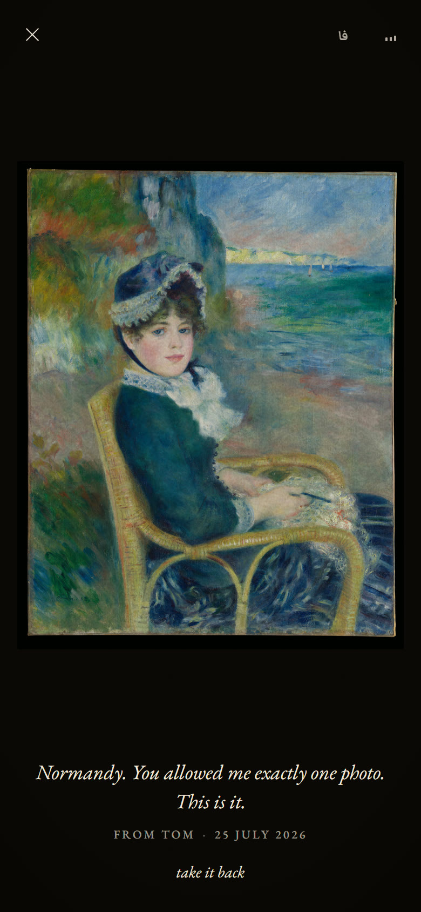
  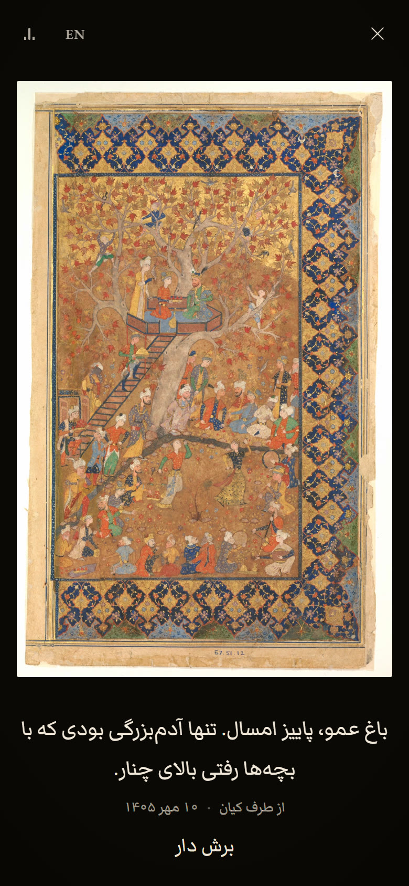
  <br><sub>Adding a photo · a shared photo, opened · the same in Persian, with a Persian-calendar date</sub>
</p>

- **You both add to it, from your own phones, any time.** Pick a photo, write a line under it, choose who it's from and post it. It appears on the wall for both of you, newest first.
- **Every photo keeps its story.** Open one to see it full screen with its caption, who added it and the date. Swipe through them all, or take an upload down again after a confirmation.
- **It's as private as the rest.** Each photo is resized and encrypted in the browser before it leaves the phone. It's stored as an encrypted file in a private GitHub repository that you own. That means it's free, there's no database that expires, and neither of you needs an account or a login.
- **It's quick on a slow connection.** The wall loads small encrypted copies, the ones on screen first, and keeps them on the phone for the next visit.
- **`…/?gallery`** opens straight onto the wall, after the password.

Setting it up takes about five minutes: see [the shared gallery](#the-shared-gallery-optional) under *Make your own*. Without it, the wall still shows every photo from the story, look-only.

## In Persian

Everything works in Persian too. The layout flips right to left, numbers and dates turn Persian, and the verses are set in Nastaliq calligraphy. The Persian sample, `example/fa`, was written in Persian from the start, around Persian miniatures. Its theme is «همون قصه‌ی قدیمی»: love is one old story, and it still sounds new.

<p align="center">
  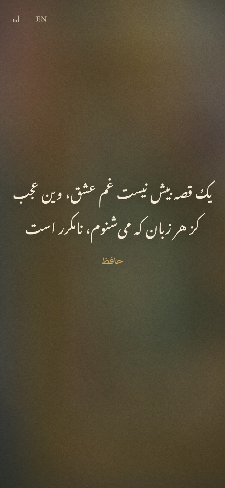
  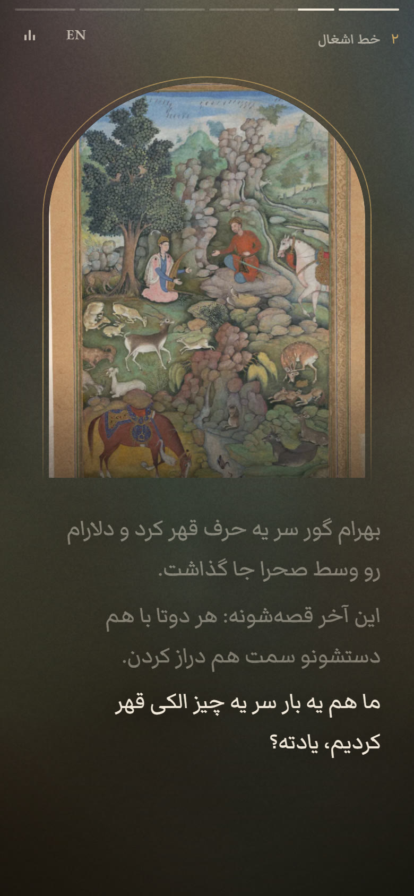
  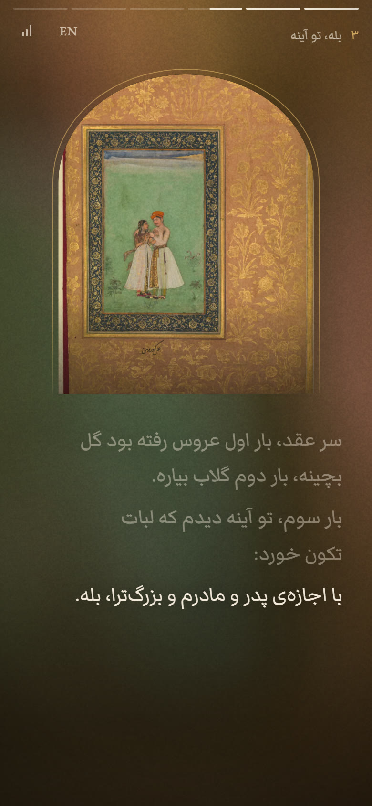
  <br><sub>The opening verse · a scene · the yes, in the mirror</sub>
</p>
<p align="center">
  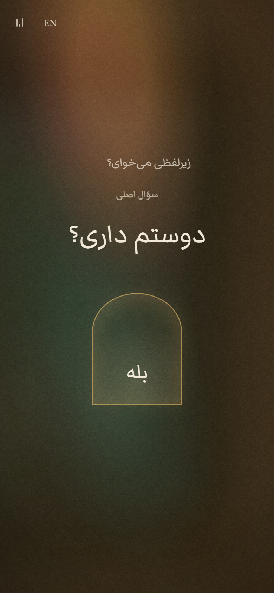
  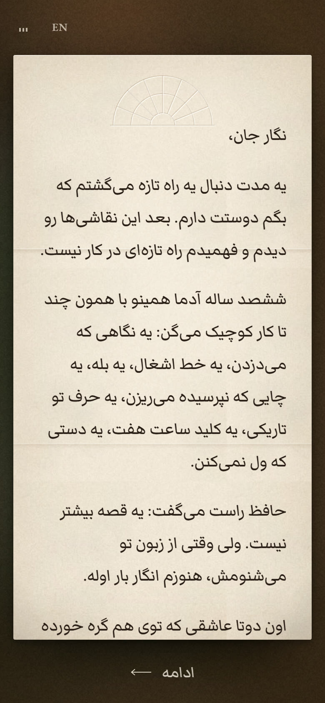
  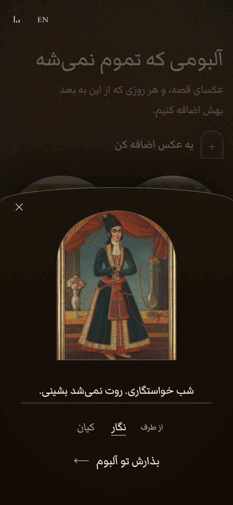
  <br><sub>The question · the letter · adding a photo</sub>
</p>

## Private by design

GitHub Pages is free for public repositories, and a Pages site is public either way. So the lock lives in the content itself.

- **Everything personal is encrypted** with AES-256-GCM under one random 256-bit key: the words, the photo list, the photos and their gallery copies. Photo metadata, GPS included, is stripped first.
- **The answer is the key to the key.** For each accepted answer, the content key is locked with a key stretched from that answer by PBKDF2-HMAC-SHA256: 600,000 iterations, with a fresh random salt on every build.
- **Decryption happens only in the browser.** The typed answer unlocks the key inside the browser's Web Crypto, where it can't be exported. Nothing is sent to a server. The optional gallery talks only to GitHub, and only sends ciphertext.
- **Without the answer, all anyone can read** is the gate (its question, hint and a few words), the page title and link preview, and the music. They can also count how many photos and answers there are.
- **Nothing personal is ever committed.** Your original photos (`Us/`) and your words and answers (`private/`) are git-ignored. Only the encrypted output is published.

```
Us/                    your photos       ┐
private/content.json   your words        ├─ node tools/build.mjs
private/secrets.json   your answer(s)    ┘          │
                                                    ▼
  assets/c.txt     all the words + the photo list      encrypted
  assets/p/*.txt   the photos (up to 2000 px)          encrypted
  assets/t/*.txt   small copies for the gallery        encrypted
  lock.json        the gate's text (plain) + the locked key
  index.html       re-stamped, so phones load the new code
```

<details>
<summary><b>Exactly what is public, and what is encrypted</b></summary>

**Public:** anyone can read these, now and forever, in the Git history.
- the code, and `index.html` (tab title, description, link-preview tags)
- `assets/og.jpg` and the music
- everything under `gate`, and `lang` (both are in `lock.json`)
- how many answers you accept: there is one locked key per answer in `lock.json`
- how many photos there are (their ids are file names), and roughly how big each one is
- every build you have ever pushed

**Encrypted:** unreadable without an answer.
- every other word in `content.json`, plus the photo list, focal points, dates and the tiny blurred previews
- the photos and their gallery copies
- the gallery's repository name and token
- every gallery upload, with its caption, who added it and when. It is encrypted before it leaves the browser.

**On their device** nothing secret is stored: the answer is typed on every visit. The browser only remembers the language, the mute setting, whether the film has been seen, who is adding photos in the gallery, and encrypted copies of gallery uploads.

The page asks search engines not to index it (`noindex`). That is not protection: the answer is the only lock.

</details>

### How strong is it?

As strong as the answer. `lock.json` is public, so anyone can try answers on their own computer, as fast as their hardware allows. There is no attempt limit and no lockout. The 600,000 rounds make each try slow: about 0.4 s on one desktop CPU core, and 1 to 2 s on a phone. But a high-end graphics card can try on the order of ten thousand answers a second, and the public question and hint tell an attacker what kind of answer to try.

| The answer is… | Time to try every possibility at 10,000 tries a second |
|---|---|
| a date, any day in the last 100 years | seconds |
| any 6-digit number | under 2 minutes |
| one word from a big dictionary, with common variations | minutes |
| 4 random words from a 7,776-word list | about 10,000 years |

### Choosing the answer

- Make it a phrase only the two of you know: a sentence rather than a word, something said once and never posted. Avoid birthdays, pets' names, cities and anything on social media.
- Only letters and digits add strength, because capitals, spaces and punctuation are thrown away.
- Every extra accepted answer is another way in, so each one must be as strong as the best one.
- The hint should mean something to them and nothing to a stranger.
- Don't reuse a password from anywhere else. If an answer leaks, [re-key](#your-answer).

## Make your own

### What you need

- **Node.js 22.7 or newer** (20.19+ also works). There is nothing to `npm install`, because there are no dependencies.
- **ffmpeg and ffprobe** on your `PATH`, with the `libwebp` encoder. The usual builds include it: `winget install Gyan.FFmpeg`, `brew install ffmpeg` or `apt install ffmpeg`. To check: `ffmpeg -hide_banner -encoders | grep libwebp`.
- **Git and a GitHub account**, to publish it for free on GitHub Pages. Any static host with HTTPS also works.

### Try the sample first

Get a copy of this repository (**Code → Download ZIP**, or `git clone --depth 1`). Then, from inside the folder:

```sh
mkdir private Us
cp example/secrets.json private/
cp example/en/content.json private/     # or example/fa/content.json for the Persian sample
cp example/en/photos/* Us/              # or example/fa/photos/*
node tools/build.mjs
npx serve .
```

Open the *Local* address that `serve` prints (usually http://localhost:3000) and answer **demo**.

There are two samples, and both use every feature:

- `example/en` is *Hand Delivered*: a year apart, told in letters, with English poetry and Western paintings.
- `example/fa` is «همون قصه‌ی قدیمی», written in Persian, with Persian miniatures.

- The build replaces `lock.json`, `assets/c.txt`, `assets/p/` and `assets/t/` (the encrypted files that came with this repository) with your own. It ends with a `built … photos, … accepted answers, code version …` line.
- The first build adds a random `key` to `private/secrets.json` and says so. That key is yours from now on: keep it.
- The page must be served over HTTP on `localhost`, or over HTTPS. Browsers only allow the decryption API there, so if you open `index.html` as a file, or use the *Network* address (`http://192.168…`), every answer looks wrong. To try it on your phone, publish it.
- On Windows, run the commands in Git Bash, or copy the files by hand. `python -m http.server 8080` also works in place of `npx serve .` (then open http://localhost:8080).

### Make it yours

1. **Photos.** Replace the sample artworks in `Us/` with your photos: JPEG, PNG or WebP (convert HEIC to JPEG first). Portrait photos work best, because the arch is 4:5.
2. **Words.** Rewrite `private/content.json`. [Writing your content](#writing-your-content) explains every field. Each `file` under `photos` must match a file name in `Us/`.
3. **The answer.** In `private/secrets.json`, replace `"demo"` with the answer, and add one entry per spelling they might reasonably type ([your answer](#your-answer)). Leave the `key` line alone.
4. **The public parts.** These are not encrypted:
   - in `index.html`: the `<title>`, the `description` and the `og:` tags. `og:url` and `og:image` still point at the original site.
   - `assets/og.jpg`: your own 1200×630 link-preview image. Never use a private photo here.
   - `assets/music.m4a.txt`: keep *Clair de lune* or use your own ([music](#music)).
5. **Build and look again:** run `node tools/build.mjs`, then reload the page.
6. **Back up `private/secrets.json`** somewhere safe and offline. If you lose it, you can rebuild the story with a new key, but every photo uploaded to the gallery is lost for good.

### Publish it on GitHub Pages

Publish from a **new** repository rather than a fork. A fork would carry this project's whole history, the original gift's ciphertext included, and stay publicly linked to it. Create an empty repository on GitHub, then:

```sh
rm -rf .git                 # if you cloned: start your own history
git init -b main
git add .
git status                  # nothing from Us/ or private/ may be listed
git commit -m "for you"
git remote add origin https://github.com/YOUR-NAME/YOUR-REPO.git
git push -u origin main
```

Turn on Pages in *Settings → Pages → Build and deployment*: **Deploy from a branch**, `main`, `/ (root)`. A minute later the site is at `https://YOUR-NAME.github.io/YOUR-REPO/`. Send the link, and tell them that capitals and punctuation don't matter.

- `example/` and `docs/` are only here for the showcase. Delete them from your copy if you like.
- Keep `.gitignore`: it keeps `Us/` and `private/` out of Git, and everything you commit gets published. Keep `.gitattributes`: it stops Git from changing line endings in the encrypted `.txt` files, which would corrupt them (this matters most on Windows). Keep `.nojekyll`, so GitHub Pages serves the files exactly as they are.
- The encrypted files and the music end in `.txt` on purpose, because download managers grab `.bin` and `.m4a` links. Don't rename them.
- **To change something later,** edit the private files, build, commit and push. Each build re-encrypts every photo (a few hundred KB each), so every pushed build adds a full copy to the repository's history. Batch your edits.

<details>
<summary><b>What's where</b></summary>

```
index.html app.js gallery.js sound.js lock.js style.css   the site                          public
lock.json, assets/c.txt, assets/p/, assets/t/              built: gate text (plain) + the
                                                           encrypted words and photos        public
assets/music.m4a.txt, assets/og.jpg                        yours, NOT encrypted              public
assets/fonts/                                              web fonts and their licenses      public
tools/build.mjs, tools/lock.test.mjs                       the builder, and its self-test
example/en/, example/fa/, example/secrets.json             the two samples (answer: demo)
Us/        your original photos                            git-ignored, never published
private/   content.json, secrets.json,                     git-ignored, never published
           gallery-token.txt (optional)
```

`node tools/lock.test.mjs` checks the encryption code and prints `lock ok`.

</details>

### Music

- The page loops `assets/music.m4a.txt`. It fades in as the gate opens, and there is a mute button in the corner.
- It is an ordinary AAC `.m4a` file with `.txt` added to the name. For example: `ffmpeg -i song.mp3 -vn -c:a aac -b:a 128k music.m4a`, then rename it to `music.m4a.txt`.
- Keep it to a few MB, because it starts downloading while the gate is showing. With no file, the site simply stays silent.
- It is not encrypted, so use music you're allowed to publish, and credit it in `credits`. The recording in this repository is CC BY 3.0, so credit its performer too ([credits](#credits-and-licenses)).

### The shared gallery (optional)

After the film, the gallery shows every photo in the story. In the sample it is look-only. With this set up, you can both add photos (with a caption, and who it's from) and take them down again. Neither of you has to log in: a token inside the encrypted bundle handles that.

Each upload is resized in the browser (1600 px, plus a 560-px-wide copy for the grid), **encrypted in the browser with the same key**, and stored as a file in a separate private GitHub repository. GitHub only ever sees encrypted bytes, file names made of the upload time, and the commit messages "add a memory" and "remove a memory".

1. **Create a private repository** for the uploads, for example `your-name/our-wall`, with a README so that the `main` branch exists.
2. **Create a fine-grained personal access token** in *Settings → Developer settings → Personal access tokens → Fine-grained tokens*:
   - Resource owner: you.
   - Repository access: **Only select repositories**, then the upload repository only.
   - Permissions → Repository permissions → **Contents: Read and write**. GitHub adds *Metadata: Read-only* by itself. Nothing else.
   - Expiration: your choice (see below).
3. **Paste the token** into `private/gallery-token.txt`, on its own.
4. **Add `github`** to `private/secrets.json` ([your answer](#your-answer)), then build and publish.

The token only travels inside the encrypted bundle, but anyone who can open the site could dig it out of their browser. That is why it must reach only that one repository, with Contents permission only.

- **Without a working token** (none, expired or revoked), the gallery shows only the story photos, and the `gallery.offline` line replaces the add button. Uploads aren't listed either, but they are safe: they come back when you put a new token in `private/gallery-token.txt`, build and publish. Never change `key` while doing this.
- **Expiry.** A token with an expiry date stops working on that date, so put a reminder in your calendar to renew it. GitHub also deletes tokens that go unused for a year.
- **Limits.** The gallery lists at most 1,000 uploads. Story photos can't be deleted from it; uploads can, after a confirmation. `gallery.js` pins GitHub API version `2022-11-28` (the `X-GitHub-Api-Version` header). GitHub keeps each version working for at least 24 months after its successor ships, so check GitHub's changelog now and then.

## Writing your content

Everything after the gate comes from `private/content.json`. Both samples, `example/en/content.json` and `example/fa/content.json`, use every feature, so the quickest start is to copy one and rewrite it line by line.

**Five rules that save an evening:**

1. **Text** is `{"en": "…", "fa": "…"}`, or a plain `"…"` for the same text in both languages. A missing `fa` falls back to English, so always fill `en`.
2. **Lists** (lines, paragraphs, replies, credits) are `{"en": […], "fa": […]}`. A bare array `[…]` shows **nothing**. An empty or missing `fa` list falls back to the English one.
3. **Line the two languages up.** Scene `lines`, `opening`, `interlude.no`, `interlude.afterYes` and `hold.lines` need the same number of entries in `en` and `fa`, and line *n* must be the same moment in both. Switching language mid-scene redraws the same line in the other language, and unequal lists can freeze the opening, the "yes" or the hold. `gate.wrong`, `finale.letter` and `credits` may differ.
4. **Counting starts at 0** for `switchAt`, `focus`, `mirror` and `interludeAfter`.
5. **There are exactly two languages.** `en` is laid out left to right. `fa` is Persian: the whole layout flips right to left, chapter numbers use Persian digits, and gallery dates use the Persian calendar. For English only, see [one language only](#one-language-only).

The film runs in this order: the gate, the opening (verse, title, date, opening lines, *begin*), the scenes (with the question after scene `interludeAfter`), the hold, the letter, the credits and end card, then the gallery.

| Key | Required? | What it is |
|---|---|---|
| `lang` | no, default `"en"` | first-visit language: `"fa"` or `"en"` |
| `gate` | yes | the password page. **Public.** |
| `photos` | yes | every photo, by id |
| `title`, `date` | no | the opening's title, and the small line under it |
| `epigraph` | yes | the verse that opens the film |
| `opening` | no | lines under the title |
| `scenes` | yes, at least one | the rooms of the story |
| `interludeAfter`, `interlude` | no, yes | where "Do you love me?" goes, and its words |
| `hold` | yes | hold my hand |
| `finale` | yes | the letter |
| `credits`, `coda` | no | end credits, and a verse for the end card |
| `gallery`, `ui` | yes | gallery and button wording |
| `names` | no | your two names, for the gallery |

"Yes" means the object must exist, or that screen breaks. Any string inside it may be empty.

A scene with three of its moments:

```json
{
  "key": "window",
  "photos": ["01", "02"],
  "moment": "fog",
  "switchAt": 1,
  "focus": { "2": [0.5, 0.4] },
  "label": { "en": "The window that morning", "fa": "پنجره‌ی اون صبح" },
  "lines": {
    "en": ["You breathed on the glass and drew a door.", "Then you opened it.", "I have been walking through it ever since."],
    "fa": ["رو شیشه‌ی بخارگرفته یه در کشیدی.", "بعد بازش کردی.", "از اون موقع دارم ازش رد می‌شم."]
  }
}
```

The first photo starts behind fogged glass, and the lines begin once it's wiped. Photo `02` develops in with line 1 (counting from 0), and with line 2 the camera glides towards the point 50% across and 40% down.

### Field by field

<details>
<summary><b>The gate</b> (public)</summary>

Everything under `gate` is copied **in plain text** into `lock.json` and shown before the answer. Anyone with the link, or anyone who finds the repository, can read it. Never put the answer here, or a hint that would help a stranger.

| Field | Type | Where it shows |
|---|---|---|
| `label` | text | small label under the stained-glass window |
| `intro` | text | the italic sentence |
| `question` | text | the question. Its answer is the password. |
| `placeholder` | text | inside the empty answer field |
| `button` | text | the open button |
| `wrong` | list | one reply per wrong answer, in order, starting over after the last. If empty: only a shake. |
| `hint` | text | appears after the third wrong answer, and stays |
| `welcome` | text | written in the light right after it opens. Empty skips that moment. |
| `verse` | optional `{fa, en, poet}` | a couplet under the form, there from the start (see *Verses and the opening* below). `en` is **required** whenever `verse` exists, or English shows the word "undefined". |
| `verseLabel` | optional text | small label above that verse |

If the encrypted words can't be downloaded after a right answer (no signal), the gate resets and shows the next `wrong` reply. Keep the replies gentle ("not quite") rather than flat ("wrong!").

</details>

<details>
<summary><b>Photos</b></summary>

```json
"photos": {
  "01": { "file": "first-walk.jpg", "focal": [0.5, 0.35], "date": "2025-03-21" },
  "02": { "file": "hands.jpg", "focal": [0.48, 0.66] }
}
```

- **The id** (`"01"`) is how scenes and `hold` refer to a photo. It becomes a public file name (`assets/p/01.txt`), so keep it plain. Zero-pad ids (`01` … `09`, `10`), because the gallery sorts them as text.
- **`file`** (required): the file name inside `Us/`. It is never published.
- **`focal`** (optional, default `[0.5, 0.5]`): the point that matters, as `[x, y]` fractions of the photo, where `[0, 0]` is top-left. It stays in view when the photo is cropped into the arch or a gallery tile, the slow drift moves around it, and on the `hold` photo the hold button sits exactly on it.
- **`date`** (optional, `YYYY-MM-DD`): shown in the gallery's full-screen view, as "21 March 2025" in English and "۱ فروردین ۱۴۰۴" in Persian.
- Every listed photo is encrypted and appears in the gallery, even if no scene uses it. It then has no caption.
- The builder fits each photo inside 2000×2000 px as WebP, makes a 560-px-wide gallery copy and a tiny blurred placeholder, strips all metadata (GPS included) and applies the phone's rotation flag. If a portrait photo comes out sideways, your ffmpeg is too old: rotate the original.

</details>

<details>
<summary><b>Verses and the opening</b>: <code>title</code>, <code>date</code>, <code>epigraph</code>, <code>coda</code>, <code>opening</code></summary>

- **`title`** (text): the big title, revealed word by word on the opening. It also heads the chapter menu. The browser-tab title lives in `index.html`.
- **`date`** (text): the small line under the title, in free text. Separate parts with ` · ` (space, middle dot U+00B7, space) and they get a wider gap, because a bare dot next to Persian digits reads like a zero. For example: `"Lisbon · spring 2025"`.
- **`opening`** (list): lines under the title, revealed one at a time (a tap hurries them). Then comes the *begin* button (`ui.begin`).

The verses are `epigraph` (opens the film, required), `coda` (on the end card, optional) and `gate.verse` (optional):

```json
"epigraph": {
  "fa": "در ازل پرتو حسنت ز تجلی دم زد\nعشق پیدا شد و آتش به همه عالم زد",
  "en": "In the beginning, the light of your beauty shone out;\nlove appeared, and set the whole world on fire.",
  "poet": { "en": "Hafez", "fa": "حافظ" }
}
```

- `fa` is the couplet in Persian script. It is set in a Nastaliq calligraphy font and shown **in both languages**.
- `en` is the translation, shown only in English. `poet` is text, shown with the couplet.
- In the `epigraph`, `\n` (or ` / `) splits `fa` into exactly two lines. Each stays on one line, and the font shrinks to fit. In `coda` and `gate.verse`, `\n` is an ordinary line break, and the coda's `en` turns line breaks into spaces.
- The epigraph stays on screen for about nine seconds, or until a tap. For an English-only site, leave `fa` empty and put the poem in `en`.

</details>

<details>
<summary><b>Scenes</b></summary>

Each scene is one room: an arch with one or two photos, and a few lines. The lines appear one by one, on their own after 1.8 s plus 45 ms per character, or with a tap, swipe or arrow key. Tapping the left 30% of the screen goes back (the right 30% in Persian), and pressing and holding pauses. After the last line, "tap to continue" (`ui.tap`) appears after 5 s.

| Field | Type | What it does |
|---|---|---|
| `key` | string | a name for the scene. `"glass"` makes the colored window light brighter, `"brick"` makes it faint, and any other value gives the normal light. |
| `photos` | 1 or 2 photo ids | the photo, and optionally a second one that cross-fades in. Further ids are ignored by the story, but still appear in the gallery. |
| `switchAt` | number, default `2` | the line where the second photo appears. Going back before that line brings the first photo back. |
| `focus` | `{"2": [x, y]}` | when that line appears, the camera slowly pushes in towards `[x, y]` on whichever photo is showing. That photo then stops drifting. |
| `mirror` | list of line numbers | those lines arrive mirror-written, then turn round to read normally |
| `moment` | `"fog"` | the first photo starts behind fogged glass with the `ui.wipe` hint. It clears once enough is wiped (or by itself after about 7 s untouched), then the lines begin. |
| `label` | text | the chapter title: in the top bar on phones, on a placard beside the lines on wide screens, in the chapter menu, and as the photo's description for screen readers |
| `lines` | list | the monologue. 3 to 5 short lines keep the photo large on a phone. |

Chapters are numbered i, ii, iii … in English, and with Persian digits in Persian.

</details>

<details>
<summary><b>The question, the hold, the letter and the credits</b></summary>

**`interludeAfter`** is the number of the scene the question follows, counting from 0. If it is missing or out of range, the question comes after the last scene. It is asked once per viewing.

| `interlude` field | What it does |
|---|---|
| `label` | small label |
| `question` | the question |
| `yes` | the arch-shaped Yes |
| `no` | the No button's labels, in order. Each try makes No jump away and show the next label; No shrinks and Yes grows. With *n* labels, the *n*-th try turns it into `noFinal`. |
| `noFinal` | No stops running and shows this. Pressing it counts as yes. |
| `afterYes` | lines after the yes, followed by `ui.continue` |

| `hold` field | What it does |
|---|---|
| `photo` | photo id (required, must exist in `photos`). The hold button sits on its `focal` point, so set `focal` on your hands. |
| `prompt` | the sentence under the photo, and the button's name for screen readers |
| `lines` | shown after about two seconds of holding, then the letter follows. If empty: a short pause, then the letter. |

If they let go early, the ring drains back and nothing breaks.

**`finale.letter`** is a list of paragraphs on a sheet of paper they can scroll and select text on (`en` and `fa` may have different numbers of paragraphs). **`finale.signoff`** is aligned to the end of the line at the bottom, followed by a drawn flourish. `ui.continue` then leads to the credits.

**`credits`** is a flat list of pairs: role, name, role, name … An **empty role `""`** turns the entry after it into the closing line.

```json
"credits": {
  "en": ["photographs", "the two of us", "music", "Clair de lune, Claude Debussy", "", "for you, always"],
  "fa": ["عکس‌ها", "خودمون دوتا", "موسیقی", "آهنگ «Clair de lune» از کلود دبوسی", "", "برای تو، همیشه"]
}
```

The roll glides to a stop with the closing line in the middle of the screen, holds it for a moment, then gives way to the end card: the `coda` (if any), `ui.theEnd`, and the `ui.toGallery` and `ui.again` buttons. Use exactly one closing line, at the end, because the roll stops at the first one it finds. Without one, the roll scrolls off the top. Pressing and holding pauses the roll.

</details>

<details>
<summary><b>Gallery, names and buttons</b>: <code>gallery</code>, <code>names</code>, <code>ui</code></summary>

| `gallery` field | Where it shows |
|---|---|
| `title`, `subtitle` | the gallery heading, and the line under it |
| `add` | the add button, and the prompt in the add sheet |
| `caption` | the caption field. Captions are optional, up to 140 characters. |
| `from` | the label before the two names in the add sheet, and the word before a name under a photo |
| `send` | the upload button |
| `uploading`, `done`, `error` | upload status messages |
| `empty` | shown while nothing has been uploaded yet |
| `offline` | replaces the add button when uploads aren't possible (no token, or it expired) |
| `delete`, `confirmDelete` | the delete button (and its confirm button), and the confirmation question |

**`names`** is `{"her": text, "me": text}`: `her` is the person you made it for, `me` is you. In the add sheet, two buttons after `gallery.from` say who is adding the photo; the default is `her`, and each device remembers its choice. The full-screen view shows `from <name> · <date>` under each photo. Photos from the story always count as `me`. Without `names`, the "from" part is left out.

| `ui` field | Where it shows |
|---|---|
| `begin` | the opening's start button |
| `tap` | the hint after a scene's last line |
| `wipe` | the hint on the fogged glass |
| `continue` | after the interlude, and after the letter |
| `theEnd` | the end card |
| `again` | "watch again", on the end card and in the menu |
| `toGallery` | the gallery button on the end card and in the menu, and the skip button on return visits |
| `close` | close buttons (for screen readers), and "no" in the delete confirmation |
| `welcomeBack`, `chapters`, `letterChap` | the menu: the label at the top, the label above the chapter list, and the entry for the letter |

</details>

<details>
<summary><b>Mixing scripts, half-spaces and small labels</b></summary>

- **A Latin phrase inside a Persian line** (or the reverse) keeps its word order and stays on one line in the lines that appear word by word: `title`, `opening`, scene `lines`, `interlude.question`, `interlude.afterYes` and `hold.lines`, and in credit names. Keep such phrases short. The line's direction follows whichever script has more words. In every other field the first letter decides the direction, so don't start a Persian sentence with a Latin word there.
- **Type Persian normally,** half-spaces (ZWNJ) included. The page renders them correctly, iPhones included.
- **Small labels** are shown in capitals in English: `gate.label`, `interlude.label`, poet names, the date line, chapter titles in the top bar, credit roles, `ui.welcomeBack`, `ui.chapters` and the "from …" line under photos. Write them in normal case.
- The visitor switches language with the فا/EN button, and the choice is remembered on their device.

</details>

### One language only

- Fill only `en` (every `fa` falls back to it), and set `"lang": "en"`.
- Leave the verses' `fa` empty, as the English sample (`example/en`) does, and put English poetry in `en`.
- Hide the language button by adding `#lang{display:none}` to `style.css`. Otherwise the button still flips the layout to right-to-left.

### Your answer

`private/secrets.json` holds the answers, the content key and the optional gallery settings:

```json
{
  "answers": ["you have paint on your nose", "you've got paint on your nose", "رو دماغت رنگه"],
  "github": { "repo": "your-name/our-wall", "branch": "main", "dir": "uploads" }
}
```

**`answers`** (required) lists every answer that opens the site, and each one gets its own locked copy of the key. Matching is forgiving, on purpose:

| Ignored | Example |
|---|---|
| capitals | `Blue` = `blue` |
| spaces, punctuation, symbols, emoji | `You have PAINT on your nose!` = `youhavepaintonyournose` |
| Arabic vs Persian letter forms | ي ى ئ = ی · ك = ک · ة = ه · ؤ = و · أ إ آ ٱ = ا |
| Persian and Arabic digits | ۱۴۰۴ = ١٤٠٤ = 1404 |
| tatweel, half-spaces, short-vowel marks | کـتاب = کِتاب = کتاب |
| full-width letters | ＢＬＵＥ = blue |

Accents on Latin letters (`café` ≠ `cafe`), `ۀ` vs `ه`, and different words (`you've got` ≠ `you have`) still count. So add a separate answer for each spelling they might reasonably type, for example the Persian form and a Latin transliteration. An answer must contain at least one letter or digit.

**`key`** is added by the first build. It encrypts the words, the photos and every gallery upload. Don't edit it, and keep a backup.

**Changing answers vs re-keying.** Editing `answers` and rebuilding re-locks the *same* key under the new answers. That's fine for adding an answer or fixing a typo, but it does **not** shut anyone out: the old `lock.json` is still in your public Git history, still opens with the old answer, and gives the same key, which also opens every new build and upload. To really revoke an answer, **re-key**: delete the `key` line, build and publish. This has two costs:
- whatever was already published stays readable with the old answer, because Git history can't be un-published;
- photos already in the gallery were encrypted with the old key, so they become blank tiles. Keep copies first; the blank tiles can be deleted.

**`github`** (optional) connects [the shared gallery](#the-shared-gallery-optional): `repo` is `"owner/name"`, `branch` defaults to `"main"`, and `dir` is the folder for uploads (the repository's root by default; small copies go in `<dir>/t/`). The token can go in a `token` field here, but a separate `private/gallery-token.txt` is easier to keep out of screenshots and copies. If both exist, the `token` field wins.

## Links and options

The answer is asked on every visit. Links only decide where it leads afterwards.

| Link | After the answer |
|---|---|
| `…/` | the film, from the start |
| `…/?gallery` or `…/#gallery` | straight to the gallery |
| `…/?menu` or `…/#menu` | the menu: watch again, the gallery, any chapter, or the letter |
| `?lang=en`, `?lang=fa` | start in that language (overrides the remembered choice and `lang`) |
| `?fresh` | forget "already seen" on this device |
| `?qa` | for testing: automatic waits are four times shorter |

Combine them with `&`, for example `…/?menu&lang=en`.

- **Return visits.** Once a device has reached the letter, the credits or the gallery, it remembers that. Later visits still start from the opening, but a small button in the top corner skips straight to the gallery. The menu never opens by itself: send the `?menu` link if you want them to have it. The gallery is the last screen; to watch again from there, reload the page.
- **Testing one screen.** After unlocking, type one of these in the browser console: `__lg.go('scene', 2)` for the third scene, `__lg.go('interlude')`, `__lg.go('hold')`, `__lg.go('letter')`, `__lg.go('credits')`, `__lg.go('gallery')`, `__lg.go('menu')` or `__lg.go('opening')`.

## Troubleshooting

| What you see | Why, and what to do |
|---|---|
| `SyntaxError: Named export 'b64' not found` | Node is too old: use 22.7+ (or 20.19+). `lock.js` is an ES module with no `package.json`, which older versions don't detect. Stuck on Node 19 to 20.18? Add a `package.json` containing `{"type": "module"}`. |
| `TypeError: Cannot read properties of undefined (reading 'subtle')` | Node 18 or older, which has no built-in Web Crypto |
| `spawnSync ffmpeg ENOENT` | ffmpeg isn't on your `PATH` |
| `Unknown encoder 'libwebp'` | your ffmpeg lacks WebP. Install a standard full build. |
| `secrets.answers is not iterable` | `answers` is missing from `private/secrets.json` |
| every answer is "wrong" while testing | you opened the file directly, or used a LAN address. Use `http://localhost` or the HTTPS site. |
| every answer is "wrong" on the live site | the published `lock.json` is older than your `answers` (build and push again); or, after a re-key, `lock.json` and `assets/` come from different builds; or the connection dropped while loading |
| a photo is sideways | your ffmpeg is old. Rotate the original. |
| a scene's second photo never appears | `switchAt` is past the scene's last line |
| the opening, the "yes" or the hold stops after switching language | the `en` and `fa` lists have different lengths |
| "undefined" under the gate verse in English | `gate.verse.en` is missing |
| the gallery shows the `offline` line, and old uploads are gone | no token, or it expired or was revoked. Make a new token, build, publish. |
| an English-only site still shows the فا button | add `#lang{display:none}` to `style.css` |

## Tech notes

- **No framework, no dependencies, no bundler.** About 170 KB of hand-written HTML, CSS and ES modules, served as static files. The builder is one short Node script that calls ffmpeg.
- **One crypto module for both sides.** `lock.js` runs in the browser and in Node, on Web Crypto in both: AES-256-GCM with a fresh random 12-byte nonce per file, and PBKDF2-HMAC-SHA256 (OWASP's 600,000 iterations) to unwrap the content key, so its raw bytes never pass through page memory. `tools/lock.test.mjs` checks it.
- **Choreography** uses the Web Animations API. Every screen owns its timers, and leaving a screen cancels them. Words are revealed one at a time, and a Latin phrase inside a Persian line is kept as one isolated run, so its word order survives.
- **Sound.** *Clair de lune* plays through a Web Audio gain node, because iOS ignores `audio.volume`. Every other sound is synthesized live: glass chimes, a soft tick for a wrong answer, the hiss of a finger on fogged glass that follows its speed, the No button's bloop, a swell when Yes is pressed, a heartbeat, a rustle of paper. They are tuned to D♭ major pentatonic, the key of *Clair de lune*, and share one generated reverb.
- **The fog** is a canvas: the photo is drawn tiny and scaled back up (a blur every engine can do), breath and droplets are painted over it, and a soft fingertip brush erases it. A coarse grid tracks how much glass is clear.
- **Smooth on modest phones.** No animated CSS blur anywhere: blurred placeholders are made once, at build time, and the drifting colored light is gradients rather than blur filters. Full-size images are released once a screen fades out, gallery tiles decrypt the visible ones first, six at a time, and the film grain stands still on touch screens.
- **iPhone care.** The audio is unlocked inside the answer's tap, with half a second of silence, so the real track can start whenever its download lands. The gate and the caption field lift above the keyboard, and Persian half-spaces get a fix for WebKit (Safari, and Telegram's in-app browser).
- **Never yesterday's code.** GitHub Pages lets browsers cache files for 10 minutes, so the builder stamps a content hash into `index.html`: into the stylesheet link and into an import map for the modules.
- **Accessibility.** Reduced motion turns movement into fades, and the credits become crossfaded pages. The story works with the arrow keys and Space (mirrored in Persian), and lines are announced as they appear. The hold works with Space or Enter, and even the No button escapes a key press, handing focus to Yes.

## Credits and licenses

- **Code:** MIT, see [LICENSE](LICENSE).
- **Fonts** in `assets/fonts/`, each under the [SIL Open Font License 1.1](https://openfontlicense.org/), with its license text alongside:
  - [EB Garamond](https://github.com/octaviopardo/EBGaramond12), Copyright 2017 The EB Garamond Project Authors
  - [Markazi Text](https://github.com/BornaIz/markazitext), Copyright 2017 The Markazi Text Project Authors
  - [Noto Nastaliq Urdu](https://github.com/notofonts/nastaliq), Copyright 2022 The Noto Project Authors
- **Music** (`assets/music.m4a.txt`): "Clair de lune" (*Suite bergamasque*, L. 75, No. 3) by Claude Debussy, performed by Laurens Goedhart (2011), licensed [CC BY 3.0](https://creativecommons.org/licenses/by/3.0/), via [Wikimedia Commons](https://commons.wikimedia.org/wiki/File:Clair_de_lune_%28Claude_Debussy%29_Suite_bergamasque.ogg). Re-encoded to AAC. The composition itself is in the public domain.
- **Sample images** in `example/en/photos/`, `example/fa/photos/` and the screenshots: public-domain paintings from [The Metropolitan Museum of Art](https://www.metmuseum.org/), released through its Open Access program under [CC0](https://creativecommons.org/publicdomain/zero/1.0/).

<details>
<summary>The 24 sample paintings</summary>

**English sample**

- *A Spanish Garden*, Martín Rico y Ortega (Spanish, 1833–1908), 1871 ([The Met, 437462](https://www.metmuseum.org/art/collection/search/437462))
- *Schloss Milkel in Moonlight*, Carl Gustav Carus (German, 1789–1869), ca. 1833–35 ([The Met, 788905](https://www.metmuseum.org/art/collection/search/788905))
- *The Love Letter*, Jean Honoré Fragonard (French, 1732–1806), early 1770s ([The Met, 436322](https://www.metmuseum.org/art/collection/search/436322))
- *Young Woman with a Lute*, Johannes Vermeer (Dutch, 1632–1675), ca. 1662–63 ([The Met, 437880](https://www.metmuseum.org/art/collection/search/437880))
- *By the Seashore*, Auguste Renoir (French, 1841–1919), 1883 ([The Met, 437430](https://www.metmuseum.org/art/collection/search/437430))
- *Two Young Girls at the Piano*, Auguste Renoir (French, 1841–1919), 1892 ([The Met, 459112](https://www.metmuseum.org/art/collection/search/459112))
- *Roses*, Vincent van Gogh (Dutch, 1853–1890), 1890 ([The Met, 436534](https://www.metmuseum.org/art/collection/search/436534))
- *Roses and Lilies*, Henri Fantin-Latour (French, 1836–1904), 1888 ([The Met, 437996](https://www.metmuseum.org/art/collection/search/437996))
- *The Letter*, Camille Corot (French, 1796–1875), ca. 1865 ([The Met, 435976](https://www.metmuseum.org/art/collection/search/435976))
- *Cannon Rock*, Winslow Homer (American, 1836–1910), 1895 ([The Met, 11113](https://www.metmuseum.org/art/collection/search/11113))
- *Antoine Laurent Lavoisier (1743–1794) and Marie Anne Lavoisier (Marie Anne Pierrette Paulze, 1758–1836)*, Jacques Louis David (French, 1748–1825), 1788 ([The Met, 436106](https://www.metmuseum.org/art/collection/search/436106))
- *Curiosity*, Gerard ter Borch the Younger (Dutch, 1617–1681), ca. 1660–62 ([The Met, 435714](https://www.metmuseum.org/art/collection/search/435714))

**Persian sample**

- *The Lovers*, Riza-yi 'Abbasi (Iran, Isfahan; Safavid), dated 1039 AH/1630 CE ([The Met, 451023](https://www.metmuseum.org/art/collection/search/451023))
- *Shah Shuja with a Beloved, Folio from the Shah Jahan Album*, Govardhan (Mughal India; Shah Jahan Album), ca. 1632 (painting side; calligraphy side ca. 1530–50) ([The Met, 451282](https://www.metmuseum.org/art/collection/search/451282))
- *Princely Couple*, Unknown artist (Iran, possibly Tabriz), 1400–1405 ([The Met, 451399](https://www.metmuseum.org/art/collection/search/451399))
- *Portrait of a Lady Holding a Flower*, Muhammadi of Herat (Safavid; Herat, present-day Afghanistan), 1565–75 ([The Met, 451323](https://www.metmuseum.org/art/collection/search/451323))
- *Bahram Gur in the Red Pavilion, Folio from a Haft Paikar (Seven Portraits) of the Khamsa (Quintet) of Nizami of Ganja*, Unknown painter (Ottoman, Istanbul); text by Nizami of Ganja, ca. 1520 ([The Met, 924978](https://www.metmuseum.org/art/collection/search/924978))
- *Love Scene*, Unknown artist (Iran, Safavid period), late 16th–early 17th century ([The Met, 447802](https://www.metmuseum.org/art/collection/search/447802))
- *Bahram Gur and the Indian Princess in the Dark Palace on Saturday, Folio 23v from a Haft Paikar (Seven Portraits) of the Khamsa (Quintet) of Nizami of Ganja*, Unknown painter (Timurid, Herat); text by Nizami, calligraphy by Maulana Azhar, ca. 1430 ([The Met, 455057](https://www.metmuseum.org/art/collection/search/455057))
- *A Young Prince*, Unknown artist (Iran, Qajar period), ca. 1820 ([The Met, 835145](https://www.metmuseum.org/art/collection/search/835145))
- *Prince in a Garden Courtyard*, Unknown artist (Iran, Tabriz; Safavid period), 1525–30 ([The Met, 446160](https://www.metmuseum.org/art/collection/search/446160))
- *Bahram Gur Sees a Herd of Deer Mesmerized by Dilaram' s Music, Folio from a Khamsa (Quintet) of Amir Khusrau Dihlavi*, Attributed to Miskin (Mughal India); text by Amir Khusrau Dihlavi, 1597–98 ([The Met, 446562](https://www.metmuseum.org/art/collection/search/446562))
- *Entertainment in a Garden, Folio from a Khamsa of Amir Khusrau Dihlavi, Matla' al-Anvar*, Unknown artist (Iran, Shiraz; Safavid period); text by Amir Khusrau Dihlavi, second half 16th century ([The Met, 451394](https://www.metmuseum.org/art/collection/search/451394))
- *Two Nightingales in a Rose Bush, Double-Sided Illustrated Leaf from an Ottoman Album*, 'Abdullah Bukhari (Ottoman, probably Istanbul), ca. 1725–45 ([The Met, 898273](https://www.metmuseum.org/art/collection/search/898273))

</details>

## License

The code is released under the [MIT License](LICENSE). The fonts, the music and the sample artworks keep their own licenses, listed above.
